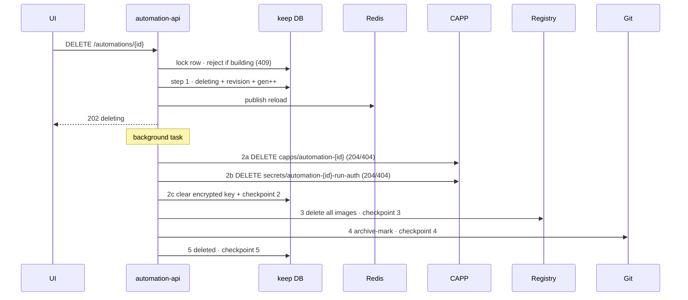

# D18 — Automation lifecycle: enable/disable, delete cascade, deboard

> Service: `keep-automation-api`. Story: D18 (`keep-automations-jira-stories.md:252`). Derived from `D18-lifecycle-plan.md` (the detailed design record — this spec is the decision-level summary).

## Intro

### The problem

Once an automation is built, its author has no way to control it. They cannot turn it off without losing it, and they cannot remove it. Removing one is not a single DB update: every automation leaves resources in three external systems — a running service (Capp) in the team's CAPP wallet, a Secret holding that service's API key, and container images in the registry — plus its script in git. If any of these are left behind, the team keeps paying for a live service, a callable `/run` endpoint with a valid key stays reachable, or images accumulate.

Deleting also has to be safe while alerts are still flowing: stop new runs first, never page a team because the automation they just deleted "failed", and survive a crash halfway through cleanup.

### Why we got this assignment

D18 is a Wave 4 story of the Automations feature (`keep-automations-jira-stories.md:500`). Authoring (D13), git (D14), builds (D15), the CAPP client (D16), and submit (D17) create automations and run them; nothing yet takes one out of service. The feature spec defines the lifecycle axis and the delete cascade (`automation-feature-spec.md` §5.3–5.4, §8.1) and the UI (G27) needs these endpoints behind its enable/disable/delete buttons.

## Requirements

### Functional requirements

**Enable / disable**

1. `POST /automations/{id}/enable` sets `matching_state=active`. If `active_digest` is empty (never built) → `400` with `{errors:[{field:"active_digest", code:"active_digest_required"}]}`.
2. `POST /automations/{id}/disable` sets `matching_state=inactive`. Runs already in flight finish; CAPP is not touched.
3. Both bump `index_generation`, write an `automation_revisions` row with the human actor, and publish Redis `reload` after commit. Matching stops/starts within the reload latency.
4. Enable/disable on a `deleting`/`deleted` automation → `409`. Building alone does not block a toggle.

**Delete**

5. `DELETE /automations/{id}` while `build_state=building` → `409`, no state change, no external calls.
6. Otherwise it returns immediately (`202`, `matching_state=deleting`) and runs one cascade attempt in the background. Repeated DELETE returns current progress and starts no new attempt; on an already-deleted automation → `200`. A stopped cascade is retried only through `resume_delete` (E21 → D20).
7. The cascade runs five steps in this exact order, saving `delete_cascade_step` after each:
   1. DB: `matching_state=deleting`, bump generation, delete revision, publish `reload`.
   2. CAPP: **2a** delete the Capp → **2b** delete the run-auth API-key Secret `automation-{id}-run-auth` → **2c** clear the encrypted DB key in the same transaction as the step-2 checkpoint.
   3. Registry: delete every image of this automation.
   4. Git: archive-mark the script path (bytes kept).
   5. DB: `matching_state=deleted`.
8. `404` from CAPP (Capp or Secret already gone) counts as success. Steps 2a and 2b run even when `capp_deployment_id` is null, so a Secret left by a half-finished first deploy is still removed.
9. Any failure (timeout, `401`/`403`, 5xx) stops the cascade at the last saved step; the automation stays `deleting`, never falsely `deleted`. The DB key is kept until both CAPP deletions succeed.
10. `resume_delete(automation_id)` continues from the step after `delete_cascade_step`. On `deleted` it is a no-op; on `active`/`inactive` it refuses (never an implicit delete). Every step is safe to repeat.
11. The team Secret named by `secret_name` is never deleted. The automation row, revisions, run history, and git script bytes are never deleted.
12. A `/run` call killed by the deletion is finalized `failed` + `failure_class=terminated_by_deletion`, with no team failure notice and no dead-letter. A run never invoked (`pending`) is finalized `suppressed` + `suppression_reason=inactive` (new enum value, keep-migrations revision `automation_suppression_reason_inactive`). A run that succeeds during teardown stays succeeded.

**Deboard**

13. `deboard_wallet(tenant_id, wallet_name, actor)` runs the same delete on every non-deleted automation with that tenant **and** wallet. Automations that are building are skipped and reported; one failure does not stop the rest; calling again resumes. Returns counts: deleted / in progress / skipped (building) / failed.

**Tenancy**

14. Routes derive tenant and actor from the session; another tenant's id → `404`.

### Non-functional requirements

- **Resumability:** correctness comes from the DB checkpoint, not the in-process task. Two runners on the same row (different replicas) may repeat a step but never move the checkpoint backward or skip a step — compare-and-set updates, not a Python lock.
- **I/O:** CAPP calls are awaited asynchronously; blocking registry/Git calls and DB transactions run in worker threads. External calls have explicit timeouts and never hold a pooled DB connection or the automation row lock (ADR-008 pattern). Exclusivity across I/O is a durable claim (`build_state=building` + deadline), not a held lock — authoring create/edit follow this too, so D14's real git client drops in unchanged.
- **Bounded lock waits:** every row-lock acquisition waits at most `DATABASE_LOCK_TIMEOUT_MS` (2000 ms); past it the request is `503` + `Retry-After`, never a statement-timeout `500`.
- **Credential hygiene:** the API key never appears in logs, errors, traces, responses, or audit rows.
- **Least surprise for teams:** D18 never changes wallet namespaces, quotas, or permissions, and never deletes a Secret the team owns.
- **Reload:** a lost `reload` publish is tolerated — B4's unconditional 30s reload converges.

## Agent implementation guide

Start with these files before changing lifecycle behavior:

- `src/bl/lifecycle.py`: enable/disable transitions.
- `src/bl/cascade.py`: deletion admission, five async cascade steps, checkpoints,
  resume, and tenant-scoped deboarding.
- `src/bl/cascade_adapters.py`: external adapter interfaces and resource naming.
- `src/bl/capp_client.py`: async Capp and run-auth Secret operations.
- `src/api/routes/user/lifecycle_routes.py`: user-facing lifecycle routes.

The implementation phases below describe the original design, not a list of
missing files. Check the current source before adding an implementation or
assuming a dependency is complete.

Current integration details:

- Every cascade step has an async interface. The runner awaits each step; the
  step offloads its own blocking work. Never wrap native async CAPP calls in a
  worker thread or hold a DB session across an external call.
- `CAPP_CLUSTER` is the default cluster for wallet-name calls. Wallet onboarding
  and tenant authorization are outside the D16 client; there is no wallet allowlist.
- CAPP URLs use names, not returned UIDs. `capp_name_for` supports legacy stored
  names and resolves UID-based deployments to `automation-{id}`.
- The run-auth Secret is always `automation-{id}-run-auth`; never delete the
  team's `secret_name`. Step 2 clears `run_api_key_encrypted` only when that ORM
  column exists. This conditional hook does not prove the migration or key
  creation flow has been delivered.
- Repeatable cleanup plus compare-and-set checkpoints provide crash recovery.
  A successful external call followed by a failed checkpoint must be safe to repeat.
- Deboarding processes every matching tenant/wallet automation, without an
  authoring-list limit. It skips building children and isolates child failures.

Verification to preserve when editing:

- Interrupt after each cascade step and between Capp deletion, Secret deletion,
  and checkpoint 2; resume with a fresh runner and verify ordering and convergence.
- Exercise lost checkpoints, adapter failures, concurrent resumes, cross-tenant
  access, and build/delete races. Never advance past failed cleanup.
- Verify deletion-aware run finalization preserves committed success and avoids
  ordinary failure notifications or retries for deletion-terminated executions.
- Use `tests/test_cascade_async.py` for event-loop and worker-thread boundaries;
  DB-backed lifecycle/cascade tests are also needed for transactional changes.
- Mocked tests do not establish live CAPP cleanup, applied migrations, or B4
  reload integration. Report those acceptance checks separately.

## Proposed Implementation

One approach; the spec (§5.4) already fixes the step order. Built in four phases.

### Phase 1 — Lifecycle routes and state transitions

New `src/api/routes/user/lifecycle_routes.py` mounted next to the existing user router (`src/main.py:123-126`), with logic in `src/bl/lifecycle.py`, reusing the tenant-scoped lookup pattern (now public `scoped_get`, `src/bl/automations_bl.py`). Each transition is one short row-locked transaction: state, `index_generation` (`src/models/db/automation.py:126`), revision, then `reload` publish after commit. The API has no Redis publisher today — add one here.

Add `active_digest_required` to `ErrorCode` (`src/contracts/validation_errors.py:11`) and to `automation-contracts.md` §"Validation errors", with a golden fixture; sync vendored copies (cross-repo event).

Extend the edit guard in `update_automation` (`src/bl/automations_bl.py:127`) to also reject `deleting`/`deleted`.

### Phase 2 — Delete cascade and resume

New `src/bl/cascade.py` owning the five steps, `delete_cascade_step` (`src/models/db/automation.py:123`) as "last completed step", and `resume_delete`. DELETE commits step 1 and — only when it performed that admission — starts one background attempt that opens its own sessions.

External calls go through injected adapters so the cascade is testable before its dependencies land:

- `CappDeletionClient` Protocol — `delete_capp(wallet, name)`, `delete_secret(wallet, name)`; D16's real client implements it.
- `GitClient.archive(automation_id, actor)` — new Protocol method beside `commit_script` (`src/bl/git_client.py:17`); D14 supplies the real one.
- Registry client using A0 credentials.

The ownership guard for the Secret is its **exact reserved name** — `caap.yaml` Secrets carry no labels we can set, and team Secrets share CAPP's managed label. The cascade only ever deletes `automation-{its own id}-run-auth`.

### Phase 3 — Races and deletion-aware run finalization

- Build vs delete share one DB admission lock: either the build wins (DELETE → `409`) or delete wins (edit/build admission fails). A late CI webhook for a `deleting`/`deleted` automation is a no-op.
- The lock is held only for short DB-only transactions. Edit claims `building` with a deadline, commits to git with no session, then finishes only if the claim is still its own (else `409`); a git failure restores the previous build state. A DELETE during an in-flight edit is an immediate `409`, not a lock wait.
- D17's submit re-checks `matching_state` before the first call and each retry. A disrupted call on a deleting automation is finalized `terminated_by_deletion` through one finalization path that bypasses team notification. Expose `finalize_terminated_by_deletion(run_id)` for D20.
- CAPP `204` does not bulk-fail `submitted` rows — a call may still return success during teardown.

### Phase 4 — Deboard fan-out

`deboard_wallet(tenant_id, wallet_name)` in `src/bl/cascade.py`, querying via the existing `(tenant_id, namespace)` index (`src/models/db/automation.py:67`) and calling the single-automation delete per row. No route, no deboard table — progress is read from the child rows.

### Dependencies D18 cannot close alone

| # | Owner | Needed |
|---|---|---|
| C1 | D20 / E21 | Stuck-run re-drive checks deletion state first; deleted automation → `terminated_by_deletion`, no team page. |
| C2 | E21 | Don't release a build lock on deadline alone while a CAPP create can still finish (would recreate an untracked Capp + Secret). |
| C3 | F23 | CI ignores the archive-marker commit so delete doesn't trigger a build. |
| C4 | D14 | Owns the real `GitClient.archive`. |
| C5 | D16 / A0 / F25 | Source of `{cluster}` for CAPP URLs. |
| C7 | keep-migrations / deploy | Apply revision `automation_suppression_reason_inactive` before deploying the API (branch `feat/d18-suppression-reason-inactive`). |
| C6 | D16 / F24 | Create the run-auth Secret + encrypted key column (`keep-migrations`); provide `delete_secret`. Record the run-auth design in the feature spec/contracts (still `TBD(CAPP)`); F25 onboarding must grant Secret delete permission. |

D18 is built and tested against fakes for these; it is not accepted until C1–C6 are agreed and the real adapters exist.

## Summary

- **Chosen approach:** three user routes (enable, disable, delete) plus `resume_delete` and `deboard_wallet` business functions in `keep-automation-api`. Delete is an async, checkpointed five-step cascade that removes the Capp, **the API-key Secret and its encrypted DB copy**, and registry images, archives the script, and keeps all audit history.
- **Key decisions:**
  - DELETE returns `409` while building — no build cancellation.
  - Disable changes matching only; no CAPP traffic toggle.
  - The run-auth API key is one credential in two places (CAPP Secret + encrypted DB copy), deleted together in step 2; the team's `secret_name` Secret is never touched.
  - Capp before Secret before registry: never leave a live service without its key mount or pointing at a deleted image.
  - Resume is a function here; the route is D20's and the schedule is E21's.
- **Out of scope / follow-ups:** `POST /internal/automations/{id}/resume-delete` route (D20); reconciler scheduling (E21); a deboard route/button and its authorization (F25/ops); creating the run-auth Secret and key (D16/F24); real git archive (D14); UI confirms (G27); run-history reads (D19).
